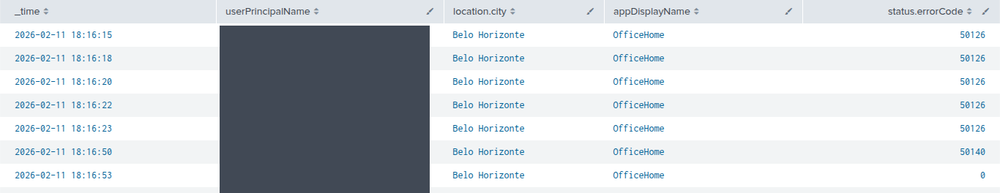
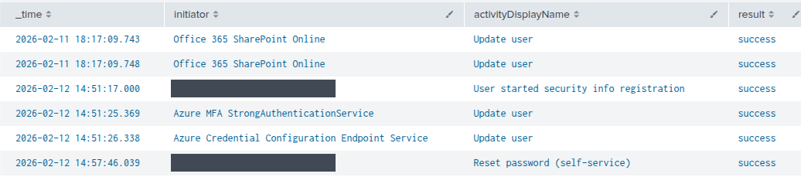
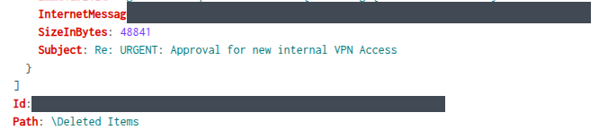

# Microsoft 365 Account Compromise Investigation

**Portfolio case study by Ibrahima Bah · Microsoft Entra ID · Exchange Online · Splunk SPL**

I investigated a simulated Microsoft 365 account compromise in TryHackMe. In Splunk, I correlated Entra ID sign-in logs, Entra ID audit logs, and Microsoft 365 Unified Audit Log events to trace a suspicious login through to actions in Exchange Online.

**Finding:** One IPv6 address accounted for 26 failed sign-ins in the lab search. The same address then successfully signed in to the affected account, created an inbox rule, sent a VPN-themed email, and accessed the reply in Deleted Items.

## Evidence timeline

Times below are as displayed in Splunk. The timezone was not independently verified.

| Date and time | Evidence | Finding |
|---|---|---|
| Feb 11, 2026 · 18:16:53 | Entra sign-in, `OfficeHome`, `status.errorCode=0` | First observed successful sign-in after the failure sequence for the affected account. |
| Feb 11 · 18:17:13 | Entra sign-in, `One Outlook Web` | First distinct app observed after OfficeHome for the same account and IP. |
| Feb 11 · 18:18:10 | Exchange, `New-InboxRule` | The source IP matched the suspicious sign-ins. The rule name referenced messages from a specific sender. |
| Feb 11 · 18:19:39 | Exchange, `Send` | The successful event recorded the VPN-themed email subject in `Item.Subject`. |
| Feb 11 · 18:20:09 | Exchange, `MailItemsAccessed` | The event from the matching IP listed both Sent Items and Deleted Items. The reply subject appeared under the Deleted Items folder entry. |
| Feb 12 · 14:51:17 | Entra audit, `User started security info registration` | The compromised account initiated security info registration on itself. |
| Feb 12 · 14:57:46 | Entra audit, `Reset password (self-service)` | The same account initiated a successful self-service password reset. |

## How I tied the evidence together

1. **Validate the sign-in.** Count failed events by IP, then rebuild the timeline for the suspicious IP. Read the user principal name and sign-in status directly from the first successful event after the failures.
2. **Separate the actor from the target.** Search Entra audit events where the account was the initiator or target. Preserve service-initiated entries for context and expand `targetResources.modifiedProperties` to compare old and new values.
3. **Trace the Exchange activity.** Filter on the account, compare the IP and time, and inspect the raw message events. The earlier mailbox-access event at 18:19:47 recorded a different IP. The 18:20:09 event matched the suspicious IP and showed the reply under `Folders → FolderItems` beneath the Deleted Items path.

The mailbox audit records establish that the rule was created and the reply was accessed. The summarized evidence does not establish that the rule moved the reply or that the VPN request resulted in access.

## Splunk evidence screenshots

These excerpts show the fields used to verify the timeline. Account and message identifiers are masked.

### Failed sign-ins followed by success

The last row shows an `OfficeHome` sign-in at 18:16:53 with error code `0`, following several nonzero results.

### Changes to the compromised identity

The audit timeline shows security info registration followed by a successful self-service password reset.

### Reply found in Deleted Items

The expanded mailbox access event places the VPN email reply under `\Deleted Items`.

## Reproduce the investigation

Use [the Splunk queries](splunk-queries.md) with the room's lab data or a dataset with equivalent fields. Replace the example account and IP with values observed in your own search. The source is the [TryHackMe M365 Monitoring Basics room](https://tryhackme.com/room/m365monitoringbasics).
